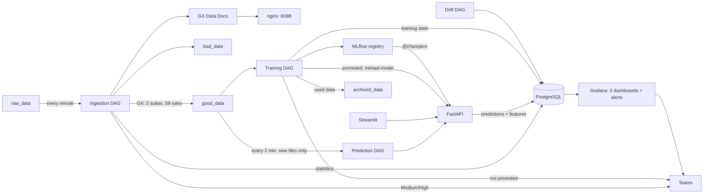

# Athlete Recovery Prediction — MLOps Platform


An end-to-end machine learning application that predicts an athlete's **recovery score (0–100)** from
training, sleep and biometric data. New data is ingested and validated continuously, predictions are
made on a schedule and on demand, the model is retrained and promoted only when it performs better,
and data quality and model behaviour are monitored with Grafana dashboards and Microsoft Teams alerts.

*Data Science in Production — EPITA.*

## Contents

1. [Architecture](#architecture)
2. [Tech stack](#tech-stack)
3. [Prerequisites](#prerequisites)
4. [Getting started](#getting-started)
5. [Configuration](#configuration)
6. [Services](#services)
7. [Project structure](#project-structure)
8. [Data](#data)
9. [Data quality validation](#data-quality-validation)
10. [Model lifecycle](#model-lifecycle)
11. [API](#api)
12. [Web application](#web-application)
13. [Monitoring and alerting](#monitoring-and-alerting)
14. [Demo scenario](#demo-scenario)
15. [Testing and linting](#testing-and-linting)
16. [Git workflow and CI/CD](#git-workflow-and-cicd)

## Architecture



| Airflow DAG | Tasks | Schedule |
|---|---|---|
| `athlete_data_ingestion` | `read_data → validate_data → send_alerts / save_file / save_statistics` | every minute |
| `athlete_prediction_job` | `check_for_new_data → make_predictions` | every 2 minutes |
| `athlete_model_retraining` | `load_data → train_model → save_training_stats → evaluate_candidate → promote_to_champion → notify_api_reload + archive_data` or `send_ml_alert` | hourly (skipped without enough new data) |
| `athlete_drift_monitoring` | `calculate_drift` | every 2 minutes |

## Tech stack

| Component | Technology |
|---|---|
| Language | Python 3.12 |
| Web application | Streamlit |
| Model API | FastAPI, Pydantic, SQLAlchemy |
| Database | PostgreSQL 16 (application data, Airflow metadata, MLflow backend) |
| Orchestration | Apache Airflow 3.x |
| Data validation | Great Expectations 1.x (Data Docs served by nginx) |
| Model tracking and registry | MLflow (model registry with the `@champion` alias) |
| Model | scikit-learn Random Forest regressor |
| Monitoring and alerting | Grafana 11, Microsoft Teams webhooks |
| Containerisation | Docker, Docker Compose |
| CI/CD | GitHub Actions (flake8, pytest, GitHub Releases) |

## Prerequisites

- **Docker Desktop** with Docker Compose v2 (`docker compose`, not `docker-compose`).
  Allocate at least **8 GB of memory** to Docker (Settings → Resources, or `.wslconfig` on Windows).
- **Git**.
- **Python 3.12** — only to run the data scripts, tests and linting outside Docker.
- Optional: two Microsoft Teams channel webhooks to receive alerts.

Free ports: 3000, 5001, 5432, 8001, 8080, 8088, 8502.

## Getting started

```bash
git clone git@github.com:SomithaG08/dsp-athlete-recovery.git
cd dsp-athlete-recovery
cp .env.example .env              # Windows PowerShell: Copy-Item .env.example .env
# edit .env: passwords, and the Teams webhook URLs to receive alerts
docker compose up --build -d
docker compose ps                 # all services up; airflow-init and db-bootstrap "Exited (0)"
```

Then generate the stream of incoming files (see [Data](#data)) so the ingestion job has data to process.

On a fresh setup the API serves the committed fallback model `models/model.pkl.gz`. The first run of
`athlete_model_retraining` registers a model in MLflow, promotes it to `@champion` and reloads the API.
If the fallback file is missing, the API still starts (`/health` → `model_loaded: false`) until that
first training run.

> **Do not run `docker compose down -v`**: it deletes the database, MLflow and Grafana volumes.

## Configuration

All settings are environment variables in `.env` (template: `.env.example`).

| Variable | Purpose | Default |
|---|---|---|
| `POSTGRES_USER`, `POSTGRES_PASSWORD`, `POSTGRES_DB`, `DATABASE_URL` | database credentials | — |
| `AIRFLOW_ADMIN_USER`, `AIRFLOW_ADMIN_PASSWORD` | Airflow login | `admin` |
| `GRAFANA_USER`, `GRAFANA_PASSWORD` | Grafana login | `admin` |
| `TEAMS_DATA_WEBHOOK_URL`, `TEAMS_ML_WEBHOOK_URL` | Teams channels for data and ML alerts | empty (alerts only logged) |
| `INGESTION_SCHEDULE`, `PREDICTION_SCHEDULE`, `TRAINING_SCHEDULE`, `DRIFT_SCHEDULE` | DAG schedules (cron) | 1 min, 2 min, hourly, 2 min |
| `MIN_NEW_TRAINING_ROWS` | new validated rows needed before retraining | 20 |
| `MAX_INFERENCE_MS_PER_ROW` | maximum inference time for promotion | 10 |
| `DRIFT_PSI_THRESHOLD`, `DRIFT_WINDOW` | drift threshold and number of recent predictions compared | 0.2, 500 |
| `DATA_DOCS_BASE_URL`, `MLFLOW_UI_URL` | base URLs used in alert links | `http://localhost:8088`, `http://localhost:5001` |
| `ALERT_TIMEZONE` | time zone of the time shown in alerts | `Europe/Paris` |

## Services

| Service | URL | Login |
|---|---|---|
| Streamlit web application | http://localhost:8502 | — |
| FastAPI (Swagger UI) | http://localhost:8001/docs | — |
| Airflow | http://localhost:8080 | `AIRFLOW_ADMIN_USER` / `AIRFLOW_ADMIN_PASSWORD` |
| MLflow | http://localhost:5001 | — |
| Grafana | http://localhost:3000 | `GRAFANA_USER` / `GRAFANA_PASSWORD` |
| Great Expectations Data Docs (nginx) | http://localhost:8088 | — |
| PostgreSQL | localhost:5432 | from `.env` |

## Project structure

```
├── .github/workflows/   CI (lint + tests) and CD (GitHub Release)
├── airflow/dags/        ingestion, prediction, training and drift DAGs
├── api/                 FastAPI model service (endpoints, Pydantic schemas)
├── database/            SQLAlchemy models and session
├── data/
│   ├── clean/           labelled baseline dataset
│   ├── demo/            defense demo files
│   ├── raw_data/        incoming files (ingestion input)
│   ├── good_data/       valid rows (prediction and training input)
│   ├── bad_data/        invalid rows, with the reason per row
│   └── archived_data/   data already used by a promoted model
├── docker/              database initialisation
├── grafana/             provisioned datasource, dashboards and alert rules
├── gx/gx/               Great Expectations suites, checkpoints and configuration
├── models/              fallback model used before the first registered champion
├── nginx/               nginx configuration serving Data Docs
├── scripts/             data generation, validation, training, drift and alert helpers
├── streamlit/           web application (multipage)
├── tests/               unit tests
├── validation/          scripts that build and run the GX suites
├── docker-compose.yml
└── .env.example
```

## Data

The dataset is a synthetic athlete recovery dataset (8,379 daily records, 19 columns) with the target
`Recovery_Score`. Features include age, gender, sport and training type, training duration and
intensity, sleep, caffeine, stress, resting heart rate, HRV, mood, muscle soreness and energy.

| Folder | Content |
|---|---|
| `data/clean/` | labelled baseline dataset (training baseline) |
| `data/raw_data/` | incoming files; each file is removed once the ingestion job has read it |
| `data/good_data/` | rows without problems — scored by the prediction job, used for retraining |
| `data/bad_data/` | rows with problems, with a `dq_errors` column giving the reason per row |
| `data/archived_data/` | good data already used to train a promoted model |
| `data/demo/` | demo files (see [Demo scenario](#demo-scenario)) |

**Generating incoming data** — inject errors with a configurable probability per error type, then split
the result into files of exactly 10 rows:

```bash
python scripts/generate_errors.py --input data/clean/athlete_recovery_synthetic.csv \
    --output data/corrupted/athlete_recovery_corrupted.csv --p-missing 0.02 --p-range 0.02 \
    --p-category 0.01 --p-type 0.005 --p-duplicate 0.003 --p-outlier 0.005    # --seed N optional
python scripts/split_dataset.py --dataset data/corrupted/athlete_recovery_corrupted.csv \
    --raw-data data/raw_data --num-files 800 --p-missing-column 0.02
```

Injected error types: missing values, out-of-range values, invalid categories, wrong data types,
duplicate records, outliers and missing columns. A missing column can be injected in the whole file
(`generate_errors.py --p-missing-column 1` or `--drop-column <name>`) or in some files only
(`split_dataset.py --p-missing-column`).

Dataset decisions: the 604 missing `Sleep_Duration_Hours` values of the clean dataset were imputed with
the median (7.5 h, `scripts/impute_sleep_median.py`); the single missing `Training_Intensity` value was
kept, so the full clean file passes 58 of 59 rules and that row goes to `bad_data`.

## Data quality validation

All rules are defined in Great Expectations (`validation/build_suites.py` builds them; `gx/gx/` stores
them) and run through checkpoints that update Data Docs. Each file is validated in two passes:

| Suite | Runs on | Rules | Category |
|---|---|---|---|
| `athlete_schema_suite` (20 rules) | the raw file | exact column set | **schema** |
| | | value types (text in a numeric column) | **type** |
| `athlete_suite` (39 rules) | numeric columns parsed | no missing values | **completeness** |
| | | value ranges (e.g. Age 18–60, Recovery 0–100) | **validity** |
| | | allowed categories, unique (`Athlete_ID`, `Day`) | **consistency** |

Checking types on the raw file first keeps every result at row level: in Great Expectations, a range
rule on a column that also contains text fails for the whole column. A value with the wrong type is
reported once, as a type error. A file with a missing column is rejected as a whole.

| Criticality | Rule | Teams alert |
|---|---|---|
| High | schema error or > 50 % invalid rows | yes |
| Medium | 10–50 % invalid rows | yes |
| Low | > 0 and < 10 % invalid rows | no |

Alerts link to the Data Docs report of that file on nginx. To validate a file manually:
`python validation/run_validation.py data/demo/demo_5_mixed.csv`.

## Model lifecycle

- **Model**: Random Forest regressor (100 trees, at least 5 samples per leaf) with median and
  most-frequent imputation and one-hot encoding, tracked in MLflow.
- **Training data**: the `data/clean` baseline plus new validated rows from `good_data` (deduplicated).
  Retraining runs only when at least `MIN_NEW_TRAINING_ROWS` new rows are available. Files already used
  by a rejected candidate stay in `good_data` but no longer count as new.
- **Fair comparison**: athletes with `Athlete_ID % 5 == 0` form a fixed holdout set that no model trains
  on; candidate and champion are scored on the same rows.
- **Promotion** to `@champion` only if the candidate's holdout RMSE is lower than or equal to the
  champion's **and** inference takes at most `MAX_INFERENCE_MS_PER_ROW`. With no champion yet, the first
  candidate is promoted. The comparison and the decision are logged on the candidate's MLflow run.
- **Promoted**: the API reloads the model and the used files move to `archived_data`.
  **Not promoted**: a Teams ML alert gives the reason and a link to the MLflow run.
- Training statistics are stored per model version; drift is measured against the **champion's**.

Manual training run: `docker compose exec airflow-scheduler python /opt/airflow/project/scripts/train_model.py`

## API

| Endpoint | Method | Purpose |
|---|---|---|
| `/health` | GET | status, `model_loaded`, active model version |
| `/predict` | POST | one athlete object, or a batch `{"features": [...], "source": "webapp" \| "scheduled"}` |
| `/batch-predict` | POST | CSV upload, returns a CSV with predictions |
| `/past-predictions` | GET | filters: `start_date`, `end_date`, `source=webapp\|scheduled\|all`, `limit` |
| `/reload-model` | POST | load the current MLflow `@champion` |
| `/monitoring/summary` | GET | recent ingestion and drift statistics |

Every prediction is stored with its input features, source and model version. The model is loaded once
at startup (FastAPI `lifespan`), and database sessions are injected with `Depends(get_db)`.

## Web application

The Streamlit application calls the API only (it never loads the model or connects to the database):

- **Prediction**: a form for a single prediction and a CSV upload for batch predictions; results are
  shown as a table with the features used.
- **Past predictions**: filter by date range and source (`webapp`, `scheduled`, `all`).
- **Dashboard**: overview charts of past predictions.

## Monitoring and alerting

Grafana dashboards (folder *DSP Monitoring*), refreshed every 30 seconds:

- **Athlete Recovery — Data Quality** (9 panels): files and rows ingested, invalid rows, High-criticality
  files, valid vs invalid rows, errors by category, invalid rows per file, files per criticality, and a
  table of ingested files with links to their Data Docs reports.
- **Athlete Recovery — Model Monitoring** (11 panels): share of low-recovery predictions, predicted score
  over time, prediction distribution, numeric and categorical feature drift (PSI), and training vs
  serving comparisons.

| Teams channel | Source | Trigger |
|---|---|---|
| Data Quality Alerts | ingestion DAG | file with Medium or High criticality |
| Data Quality Alerts | Grafana | > 30 % invalid rows in 15 min; High-criticality file in 10 min |
| ML Alerts | training DAG | candidate not promoted |
| ML Alerts | Grafana | feature drift (PSI ≥ 0.2); average prediction shift > 15 points |

Webhooks are created in Teams with *Workflows → "Post to a channel when a webhook request is received"*.
Without webhooks, the pipeline still runs and alerts are written to the task logs. Dashboards are
generated by `grafana/build_dashboards.py`.

## Demo scenario

| File (`data/demo/`) | Expected result |
|---|---|
| `demo_1_all_errors.csv` | 10/10 rows invalid, High criticality, Teams alert, file to `bad_data` |
| `demo_2_clean.csv`, `demo_3_clean.csv`, `demo_4_clean.csv` | 10/10 rows valid, files to `good_data`, scored by the prediction job |
| `demo_5_mixed.csv` | 5/10 rows invalid, Medium criticality, Teams alert, file split between `good_data` and `bad_data` |
| `demo_6_missing_column.csv` | schema error, whole file invalid, High criticality |

Empty the data folders before the demo, without losing data:

```bash
python scripts/prepare_demo.py reset     # raw/good/bad CSVs -> data/pre_demo_backup/<timestamp>/
# copy the demo files into data/raw_data one at a time
python scripts/prepare_demo.py restore   # afterwards: the raw_data backlog returns to data/raw_data
```

## Testing and linting

```bash
pip install -r requirements.txt flake8
pytest -q          # 46 unit tests
flake8 .           # configuration in .flake8
```

The tests cover criticality, file splitting, statistics, Great Expectations rules on the demo files,
Pydantic validation, API endpoints (SQLite and an empty MLflow registry, no running service needed),
error injection, alerts and drift.

## Git workflow and CI/CD

- **Branches**: `main` (released code, used for defenses), `develop` (integration) and `feature/*`.
  Every change goes through a pull request into `develop`, squash-merged (one commit per feature);
  `develop` is merged into `main` through a pull request before each release.
- **CI** (`.github/workflows/ci.yml`): on every pull request to `develop`, flake8 and pytest run as
  separate jobs.
- **CD** (`.github/workflows/cd.yml`): on every merge into `main`, a semantic version tag is created
  (`v1.0.0` for the first release) and a GitHub Release is published with notes generated from the
  merged pull requests.
